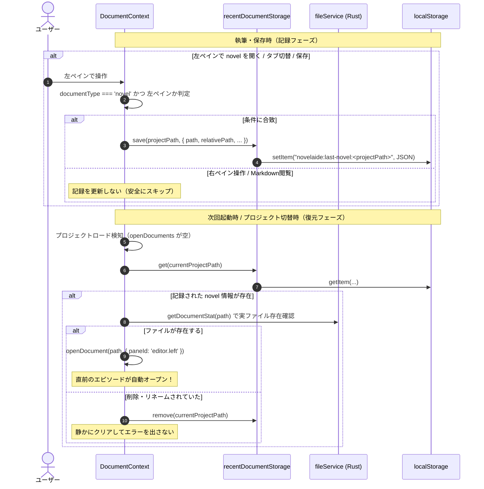

# 58. 最後に開いた小説原稿の自動復元と過剰実装からの脱却

こんにちは！ 小説執筆用エディター **`novelaide`**（コードネーム: `novelaid-e`）の開発メイキング連載第58回です。

今回は、エディターの再起動時や作品を開いた際に**「直前まで書いていた小説原稿（エピソード）が自動的に開く」軽量セッション復元機能**の実装をお届けします！

過去作での「すべてを復元しようとして破綻した」反省を生かし、作家にとって最も価値のある最小限の実装（単一エピソード × 左ペイン限定判定）をどう導き出したのか、その設計思想と実装プロセスを詳しくご紹介します。

---

## 1. 今回の課題とユーザープロンプト

### ユーザーからのリクエスト

```markdown
> /plan 現在、状態として最後に開いたプロジェクトが保持されており、
> 次回アプリを開いた時に読み込まれます。
> しかし、最後に開いていたファイルの自動読み込みはありません。
>
> `novelaid-editor`ではタブやその他状態まで復帰していたのですが、
> この実装はかなり過剰でした。
>
> そこで、今回は簡易的に最後に開いていたドキュメントのみを開くものとして検討します。
> これは、実際の作業としては、主に単一のエピソードの続きから始めたい事が多いためです。
> そこで、最後に開いていたnovelのドキュメントのみ保持するのがベターと考えられます。
> 開いていたでなく、最後に保存したnovelの方が適切かもしれません。
> novelに限定するのは、他の設定関連(markdown)はメタデータリストなどからのアクセスが簡単なこともあります。
> novelはファイルツリーの奥にあり、最初に開くときに探す必要があります。
```

さらに、設計検討の中で以下の重要な仕様が追加されました。

```markdown
> アクティブの判断については、左側ペインのみとしてください。右側ペインは基本的に参考用となり、実際の執筆中は過去のエピソードなどを扱います。
```

---

## 2. 旧実装の反省と「過剰実装」からの脱却

### なぜ前作のタブ丸ごと復元は「過剰」だったのか？
初代の `novelaid-editor` では、エディターを終了した瞬間の状態——開いていた全タブ、アクティブなタブ、左右の画面分割状態、各ペインのスクロール位置に至るまで——をすべて永続化し、次回起動時に再現しようとしていました。

一見すると親切で高機能に思えますが、実際の開発・執筆現場では以下のような深刻な課題がありました。

1. **タブの肥大化とノイズ**:
   気づかないうちに20個も30個もタブが開いたままになり、起動するたびに重いタブの山と格闘することになる。
2. **ファイル移動・削除時の不整合リスク**:
   外部でファイルをリネームしたり削除した際に、存在しない古いパスを復元しようとしてエラーや警告が多発する。
3. **「今書きたい場所」が見失われる**:
   本当にやりたいのは「今まさに執筆中の最新話の続きを書くこと」なのに、参考のために開いていた過去話や設定資料のタブに埋もれてしまい、認知負荷が増大する。

### 今回の設計思想：本質に絞った「3つの割り切り」
そこで今回は、複雑なセッション管理を一切やめ、以下の3つの割り切りを行いました。

1. **復元するのは「単一ドキュメント」のみ**:
   複数のタブを復元せず、最後に扱っていた1ファイルだけを左ペインに開きます。
2. **小説本文（`novel`）に厳密限定**:
   登場人物シートやプロットなどの設定資料（Markdown）は、サイドバーのメタデータパネルから1クリックで瞬時に開けます。一方、小説原稿は「第1部 / 第2章 / 01_出会い.md」のようにフォルダの深い階層にあり、探す手間が圧倒的に大きいため、原稿ファイルのみを復元対象とします。
3. **「左ペイン（執筆用）」限定判定**:
   2画面分割時、右ペインは過去のエピソードや設定資料を「見比べる」ための参照用です。右ペインでどれだけ過去エピソードを開いても、メインで執筆していた左ペインのエピソード記録を絶対に上書きしない仕組みにします。

---

## 3. アーキテクチャと自動復元フロー



---

## 4. 実装のポイント

### ① 永続化ユーティリティ `recentDocumentStorage.ts`
プロジェクトごとに独立したキー（`novelaide:last-novel:<projectPath>`）で管理し、ストレージアクセスを独立したモジュールへカプセル化しました。

```typescript
export interface LastNovelInfo {
  path: string;
  relativePath: string;
  fileTitle: string;
  updatedAt: number;
}

export const recentDocumentStorage = {
  save(projectPath: string, info: Omit<LastNovelInfo, 'updatedAt'>): void { ... },
  get(projectPath: string): LastNovelInfo | null { ... },
  remove(projectPath: string): void { ... },
};
```

### ② 左ペイン監視と自動保存の連動 (`DocumentContext.tsx`)
左ペインのアクティブなタブアイテム（`activeLeftItem`）が変更された際、`novel` 形式であれば即座に永続化します。

```typescript
// 左ペインのアクティブドキュメントが novel の場合、最後に開いたエピソードとして永続化
useEffect(() => {
  if (currentProjectPath && activeLeftItem && activeLeftItem.documentType === 'novel') {
    const activeLeftDoc = openDocuments.find((d) => d.path === activeLeftItem.path);
    recentDocumentStorage.save(currentProjectPath, {
      path: activeLeftItem.path,
      relativePath: activeLeftDoc?.relativePath || activeLeftItem.path,
      fileTitle: activeLeftItem.fileTitle || activeLeftItem.baseName,
    });
  }
}, [currentProjectPath, activeLeftItem, openDocuments]);
```

さらに、`saveDocument` 成功時（左ペイン関連）や、インラインファイル名変更（`renameDocument`）時にも記録パスを自動追従・更新する堅牢な配慮を組み込みました。

### ③ 実ファイル存在検証を伴う安全な自動復元
次回起動時、記録されていたファイルが外部で削除・移動されていた場合でもアプリがクラッシュしないよう、Rust 側の高速メタデータ確認（`fileService.getDocumentStat`）を挟んでいます。実在が確認できた場合のみ左ペインへスマートにロードし、存在しない場合は静かに記録を消去します。

---

## 5. まとめと次回予告

今回の改修により、作家はアプリを起動するだけで、**「迷わず、探さず、直前のエピソードの続きからすぐ執筆を再開できる」** という極めて快適な執筆環境を手に入れました！

- **旧作の反省**: 過剰なタブ復帰を排し、単一エピソード復元へ大胆にスリム化
- **作家視点の配慮**: 参考用・過去話参照の右ペイン操作は記録から完全除外
- **安全性**: 実ファイル存在チェックとリネーム追従によるエラーフリー設計
- **バージョン更新**: `v0.63.4` → **`v0.64.0`**（minor アップデート）

「高機能にすること」だけが正解ではなく、「本当に使いたい瞬間を削ぎ落としてシンプルに磨き上げること」の大切さを再認識できたアップデートとなりました。

次回もさらなる執筆体験の向上を目指して機能改善を進めていきます。お楽しみに！
