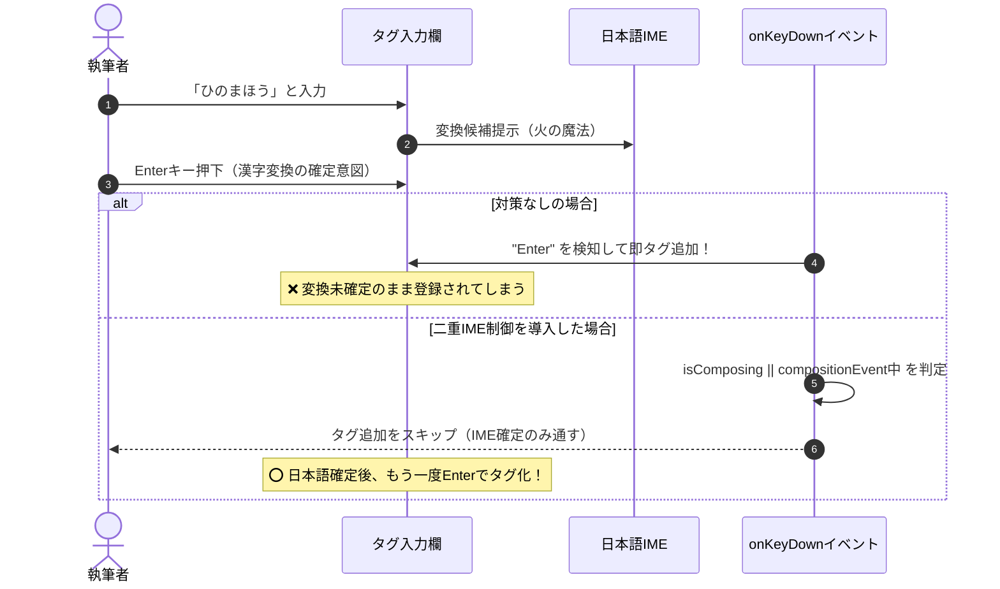

# 【第59回】カンマ区切りテキストからの脱却！モダンなタグ入力UI（Chip）と日本語IME制御の極意

こんにちは！ 小説執筆用エディター **`novelaide`**（コードネーム: `novelaid-e`）の開発メイキング連載第59回です。

小説の設定資料やキャラクターシート、章ごとのプロットを整理する際、作品の世界観を広げる「タグ（tags）」は欠かせない機能です。
しかし、これまでのメタデータ編集パネルのタグ入力欄は、単なる1行のテキストボックスに「カンマ区切り（`主人公, 魔法, 帝国`）」で入力するだけの無骨な仕様でした。

カンマの打ち忘れやタイポ、不要なスペースの混入、不要なタグの削除しづらさなど、執筆の合間に設定を整える上での小さなストレスが蓄積していました。

そこで今回は、Webフロントエンドで広く親しまれている**Chip（ピル／バッジ）形式のモダンなタグ入力UI**を完全新設し、さらに日本語入力環境特有の「Enter確定時の誤爆問題」を徹底的に解決した実装プロセスをお届けします！

---

## 1. 開発の背景と投げかけたプロンプト

まずはユーザーから寄せられた要望と、仕様策定のプロンプトをご紹介します。

### ユーザー入力プロンプト

> /plan 現在のメタデータでのタグ入力部分が、「,」区切りでの入力となっており、使いづらいです。  
> モダンな、タグインプットやチップ、トークンフィールド、ピル、バッジと呼ばれるUIにしてください。
>
> ### 1. 実装の目的・概要
> タグを入力し、確定すると削除ボタン（×）付きの角丸バッジ（Chip）として横並び・折り返し表示される入力UIを作成してください。
>
> ### 2. 機能要件
> * **タグの追加操作**:
>   * 入力欄で `Enter` キー、またはカンマ（`,`）が押されたときに現在の入力テキストをタグとして確定・追加すること。
>   * **重要（IME対策）**: 日本語入力の変換確定時の `Enter` キー（`e.nativeEvent.isComposing === true`）ではタグが確定されないよう制御すること。
>   * 入力文字列の前後の空白はトリミング（`trim()`）し、空文字や既に登録済みの重複タグは追加しないこと。
> * **タグの削除操作**:
>   * 各タグ内の「×」ボタンをクリックすると、該当のタグが削除されること。
>   * 入力欄が空の状態で `Backspace` キーが押された場合、末尾のタグが1つ削除されること。
> * **フォーカス制御**:
>   * コンポーネントの外枠（コンテナ領域）のどこをクリックしても、内部の `<input>` 要素に自動でフォーカスが当たること。
>
> ### 3. UI・デザイン要件
> * タグ（Chip）は角丸の枠線付きデザインとし、内部に「タグ文字列」と「×ボタン」を横並びで配置すること。
> * タグが増えた場合はコンテナ内で自然に折り返し（`flex-wrap: wrap`）、最後のタグのすぐ右側にテキスト入力欄が続くレイアウトにすること。

さらに計画のブラッシュアップ段階で、以下の重要操作が追加されました。

> タグ追加の確定にタブキーも追加して

テキスト入力中に `Tab` キーを押すことで、フォーカスを別の入力項目に飛ばすことなく連続してタグを確定・登録していける、非常に快適な操作感の実現が求められました。

---

## 2. タグ入力UIに立ちはだかる「日本語IME」の壁

タグ入力UI（Tokenfield / Chips Input）を自作する際、英語圏のライブラリやチュートリアル通りに作ると、**日本語入力環境で確実に破綻**します。

### 日本語変換時のEnter誤爆問題

英語であれば、単語を入力して `Enter` を押せば即座に確定で問題ありません。
しかし日本語入力（IME）では、漢字変換の候補を確定するために日常的に `Enter` キーを叩きます。

もし単純に `onKeyDown` で `e.key === "Enter"` のみを監視していると、**「ひのまほう」と入力して「火の魔法」に変換確定しようと Enter を押した瞬間に、変換途中のままタグとして追加されてしまう**という致命的な誤動作が起きます。



### 確実な二重IME判定ロジック

ブラウザやOS（Windows / macOS）、入力方式によっては `e.nativeEvent.isComposing` のフラグが `onKeyDown` 発火のタイミングで微妙に遅れて解除されるケースがあります。
そのため、今回は React コンポーネント内で **`isComposingRef`** を保持し、`compositionstart` と `compositionend` のライフサイクルを明示的に追跡する二重ガードを採用しました。

```typescript
// 日本語IME変換中のフラグ追跡
const isComposingRef = useRef(false);

const handleCompositionStart = () => {
  isComposingRef.current = true;
};

const handleCompositionEnd = () => {
  isComposingRef.current = false;
};

const handleKeyDown = (e: React.KeyboardEvent<HTMLInputElement>) => {
  // IME変換中のEnter押下はタグ化処理をスキップ
  if (e.nativeEvent.isComposing || isComposingRef.current || e.keyCode === 229) {
    return;
  }

  if (e.key === 'Enter' || e.key === ',' || e.key === '、') {
    e.preventDefault();
    commitInput(inputValue);
  } else if (e.key === 'Tab' && inputValue.trim().length > 0) {
    // 文字が入力されている時のTabはタグ確定（フォーカス移動を抑止）
    e.preventDefault();
    commitInput(inputValue);
  } else if (e.key === 'Backspace' && inputValue === '' && tags.length > 0) {
    // 入力欄が空のときのBackspaceは末尾タグを削除
    removeTag(tags.length - 1);
  }
};
```

これにより、
1. 日本語を入力して変換候補を `Enter` で確定
2. 確定された状態で、もう一度 `Enter`（または `Tab`、カンマ）を押すと綺麗に Chip バッジとして確定

という、日本語話者が直感的に期待する通りの極めて自然な打鍵感が完成しました。

---

## 3. 実装したアーキテクチャとUI構造

本機能は、メタデータ編集パネル固有の実装に閉じず、今後の検索パネルやフィルタ機能でも再利用できるよう、独立した共通コンポーネント `TagInput` として設計しました。

### ディレクトリ構成

```text
src/components/Common/
└── TagInput/
    ├── TagInput.tsx       # IME制御・キーボード・ペースト処理ロジック
    ├── TagInput.css       # 角丸Chip・:focus-within・折り返しスタイル
    └── index.ts           # 公開エクスポート
```

### 柔軟なスタイリングとコンテナクリックフォーカス

CSS では、Flexbox の折り返し（`flex-wrap: wrap`）を活用し、複数のタグが並んだすぐ右側にインラインの `<input>` が自然に続く構造にしています。

```css
.tag-input-container {
  display: flex;
  flex-wrap: wrap;
  align-items: center;
  gap: 6px;
  padding: 6px 8px;
  background-color: var(--bg-secondary);
  border: 1px solid var(--border-color);
  border-radius: 6px;
  cursor: text;
  transition: border-color 0.15s ease, box-shadow 0.15s ease;
}

/* コンテナ内のどこかにフォーカスがあるとき全体をハイライト */
.tag-input-container:focus-within {
  border-color: var(--accent-primary);
  box-shadow: 0 0 0 2px var(--focus-ring);
}

.tag-chip {
  display: inline-flex;
  align-items: center;
  gap: 4px;
  padding: 2px 8px;
  background-color: var(--bg-tertiary);
  border: 1px solid var(--border-color);
  border-radius: 12px;
  font-size: 12px;
}

.tag-chip-remove {
  background: none;
  border: none;
  cursor: pointer;
  color: var(--text-muted);
  display: flex;
  align-items: center;
  padding: 0;
}
```

コンテナ外枠をクリックした際、`containerRef` を通じて即座に内部の `<input>` にフォーカスが当たるため、ユーザーは小さな入力ボックスを探して正確にクリックする必要がありません。

### カンマ区切りテキストのペースト対応

さらに親切な配慮として、メモ帳やブラウザからコピーした「`主人公, 魔法使い, 帝国`」のようなカンマ区切りテキストを貼り付けた際、即座にカンマで分割して一括で複数タグに分解・追加するペーストハンドラも備えています。

```typescript
const handlePaste = (e: React.ClipboardEvent<HTMLInputElement>) => {
  const pasteText = e.clipboardData.getData('text');
  if (pasteText.includes(',') || pasteText.includes('、')) {
    e.preventDefault();
    const parts = pasteText.split(/[,、]/).map(s => s.trim()).filter(Boolean);
    // 重複を除外して一括登録
    ...
  }
};
```

---

## 4. メタデータ編集パネルへの統合

完成した `TagInput` は、`src/components/Metadata/MetadataPanel.tsx` にシームレスに組み込まれました。

従来のクイック分類タグ（👤登場人物、📍地名・舞台、📜プロット等）のトグルボタンを押した際も、`tags` 配列が更新されると即座に Chip バッジとして描画されます。

また、Rust 側の YAML シリアライザ（`serde_yaml`）との整合性を保つため、タグがすべて削除されて空配列（`[]`）になった際は、Frontmatter から `tags` キーそのものを安全に削除し、無駄な `tags: []` がファイル内に残らないクリーンな状態を維持します。

---

## 5. まとめと次回予告

カンマ区切りの文字列入力から、モダンな Chip / バッジ UI への進化によって、設定資料のタグ付け体験が劇的に向上しました。

- **`Enter` / `Tab` / カンマ での直感的なタグ確定**
- **日本語IME変換中の Enter 誤爆を完全防止する二重ガード**
- **クリック一発の「×」削除と、空欄時の `Backspace` 末尾削除**
- **クイック分類ボタンやコピー＆ペーストとの完璧な連動**

小さな UI パーツの改善ですが、日々の執筆や設定整理で頻繁に触る部分だからこそ、ストレスフリーな打鍵感と洗練された見た目が大きな快適さを生み出します。

次回も、小説執筆に寄り添う快適な機能改善と、開発の舞台裏を詳しくお届けします。どうぞお楽しみに！
