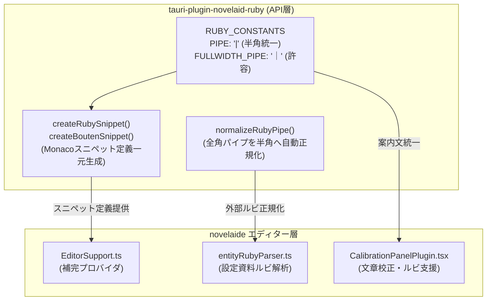

# 【第60回】エディター補完ルビ記法の半角パイプ統一とnovelaid-ruby一元管理

こんにちは！ 小説執筆用エディター **`novelaide`**（コードネーム: `novelaid-e`）の開発メイキング連載第60回です。

小説執筆において、ルビ（ふりがな）や傍点（強調）は作品の世界観やキャラクターの個性を際立たせるための最重要機能です。
`novelaide` では、カクヨム記法や小説家になろう記法に準拠した青空文庫スタイルのルビ記法をサポートしており、パイプ記号で親文字を指定する `|親文字《ルビ》` 形式を採用しています。

しかし今回、エディターで「ルビ」や「ruby」と入力した際に提示される補完スニペットにおいて、パイプ記号が**全角の「｜」**になってしまっているという問題が発見されました。

表示やパースの機能としては全角パイプも柔軟に受け入れつつも、エディターでの入力・補完・自動挿入などの生成部分は**半角パイプ（`|`）で完全に統一**し、かつ専用プラグイン **`tauri-plugin-novelaid-ruby`** 側で一元管理するアーキテクチャへと洗練させました。
今回はその改善プロセスをお届けします！

---

## 1. 開発の背景と投げかけたプロンプト

まずはユーザーから寄せられた要望プロンプトをご紹介します。

### ユーザー入力プロンプト

> エディターでの補完機能からのルビで、「|」が全角「｜」になっています。機能としては全角も許可されますが、入力部分は半角の「|」で統一します。novelaid-rubyの機能で一括管理想定です

### なぜ半角パイプへの統一が必要なのか？

小説投稿サイトや電子書籍リーダー、校正ツールの世界では、全角パイプ（`｜`）と半角パイプ（`|`）の混在が長年小さなトラブルの種になってきました。
全角パイプは日本語IMEがONの状態で打ちやすい反面、環境によってフォントのグリフ幅や描画エンジンでのパース差異が生じやすく、カクヨム等の外部プラットフォームへ貼り付けた際の互換性でも半角パイプ `|` が事実上の標準として推奨されています。

`novelaide` では以前から校正パネル（`CalibrationPanelPlugin`）やルビ挿入ダイアログ（`formatSmartRuby`）において半角パイプでの統一を進めていましたが、エディターのインテリセンス補完（スニペット定義）に全角パイプの直書き（ハードコード）が残存していました。

さらに、エディター側が独自にスニペット文字列を組み立てるのではなく、「ルビ記法に関することはすべて専用プラグイン `novelaid-ruby` に集約・一元管理させる」というアーキテクチャの徹底が求められました。

---

## 2. システムアーキテクチャの再整理

今回の改修におけるコンポーネント間の連携を Mermaid 図で整理します。



---

## 3. 実装の詳細

### 3.1. `tauri-plugin-novelaid-ruby` での定数・スニペット生成の新設

まずはプラグイン側（`guest-js/patterns.ts` および `guest-js/index.ts`）に、記法定数とスニペット生成ヘルパーを新設しました。

```typescript
// patterns.ts
export const RUBY_CONSTANTS = {
  /** 入力・標準出力で使用するパイプ記号（半角統一） */
  PIPE: '|',
  /** 読み取り時に許容される全角パイプ記号 */
  FULLWIDTH_PIPE: '｜',
  /** ルビ開始括弧 */
  OPEN_BRACKET: '《',
  /** ルビ終了括弧 */
  CLOSE_BRACKET: '》',
  /** 傍点開始記法 */
  BOUTEN_OPEN: '《《',
  /** 傍点終了記法 */
  BOUTEN_CLOSE: '》》',
};

// index.ts
export function createRubySnippet(selectedText?: string): RubySnippetOptions {
  const hasSelection = Boolean(selectedText && selectedText.length > 0);
  const escapedSelectedText = hasSelection ? selectedText!.replace(/[$}\\]/g, '\\$&') : '';

  return {
    label: 'ルビ: |漢字《かんじ》',
    insertText: hasSelection
      ? `|${escapedSelectedText}《\${1:よみ}》`
      : '|${1:漢字}《${2:よみ}》',
    detail: hasSelection
      ? `ルビ記法: |${selectedText}《…》`
      : 'ルビ記法（novelaid標準）',
    filterText: hasSelection
      ? `${selectedText} ルビ るび ruby 漢字 かんじ |｜`
      : 'ルビ るび ruby 漢字 かんじ |｜',
    documentation: hasSelection
      ? `選択中の「${selectedText}」にルビ記法を適用します。Tabキーで読みの入力へジャンプできます。`
      : '小説ルビ記法スニペット。Tabキーで漢字と読みに順次ジャンプできます。',
    sortText: '03_ruby',
  };
}
```

ポイントとして、`filterText` には半角 `|` と全角 `｜` の両方を含めています。
これにより、ユーザーが全角IMEの状態で「｜」を入力した場合でも、検索候補として確実にヒットし、挿入されるのは正しい半角パイプ `|` になるという快適な入力体験を提供できます。

### 3.2. 全角パイプの自動正規化ヘルパー (`normalizeRubyPipe`)

設定資料（キャラクターシートや舞台設定ファイル）の1行目に見出しとしてルビが書かれている場合、作家がうっかり全角パイプ `｜勝魚《かつお》` と書いてしまうことがあります。
この文字列をエディターのサジェスト辞書にそのまま登録してしまうと、補完候補に全角パイプが紛れ込んでしまいます。

そこで、ルビ記法内の全角パイプを自動で半角パイプへと補正する `normalizeRubyPipe` を実装しました。

```typescript
export function normalizeRubyPipe(text: string): string {
  if (!text) return '';
  return text.replace(/｜([^|｜\n《》]+《[^《》\n]+》)/g, '|$1');
}
```

この関数を `entityRubyParser.ts` の `parseFirstLineRubies` に組み込むことで、設定ファイルから抽出された補完アイテムも自動的に半角パイプ `|` へ統一されます。

### 3.3. エディター本体（`EditorSupport.ts`）の統合

エディター側では、これまでハードコードされていたスニペット定義を削除し、`tauri-plugin-novelaid-ruby-api` からインポートした `createRubySnippet` および `createBoutenSnippet` を呼び出す形にリファクタリングしました。

```typescript
// EditorSupport.ts
(() => {
  const rubySnippet = createRubySnippet(selectedText);
  return {
    label: rubySnippet.label,
    kind: monaco.languages.CompletionItemKind.Snippet,
    insertText: rubySnippet.insertText,
    insertTextRules: monaco.languages.CompletionItemInsertTextRule.InsertAsSnippet,
    filterText: rubySnippet.filterText,
    detail: rubySnippet.detail,
    documentation: rubySnippet.documentation,
    range: targetRange,
    sortText: rubySnippet.sortText,
  };
})(),
```

これにより、エディター本体はスニペットの書式詳細を知る必要がなくなり、ルビや傍点に関する記法定義の単一責任（SSOT: Single Source of Truth）がプラグイン側に確立されました。

---

## 4. テストと動作検証

プラグイン内の Vitest ユニットテストに以下のテストケースを追加しました。

1. **半角パイプ統一の検証**:
   - `createRubySnippet()` が出力する `label`, `insertText` がすべて半角パイプ `|` で始まっていること。
   - `insertText` 内に全角 `｜` が一切含まれていないこと。
2. **全角パイプ正規化の検証**:
   - `normalizeRubyPipe('｜親文字《ルビ》')` が `|親文字《ルビ》` に正しく変換されること。
   - ルビ記法以外の通常の文章中の縦線（パイプ）は破壊しないこと。

すべてのユニットテストおよびアプリ本体の `npm run build`（TypeScript 型検査 + Vite ビルド）を無事にパスし、完全な動作を確認しました。

---

## 5. まとめと次回予告

今回の改善により、ルビ補完機能の「入力は半角パイプ統一、判定は全角も寛容に許可」という理想的な振る舞いが実現しました。

- **エディター補完スニペットが `|漢字《かんじ》`（半角パイプ）に統一**
- **設定資料の見出しルビも自動で半角パイプへ正規化**
- **ルビ・傍点スニペット定義を `tauri-plugin-novelaid-ruby` で一元管理**

見た目の違いはわずか1文字の全角・半角ですが、小説の執筆データとしての整合性や、他プラットフォームへの移植性・公開性を保つ上で、極めて重要な基盤強化となりました。

次回も、小説執筆をより心地よく、より堅牢にする開発の模様をお届けします。どうぞお楽しみに！
