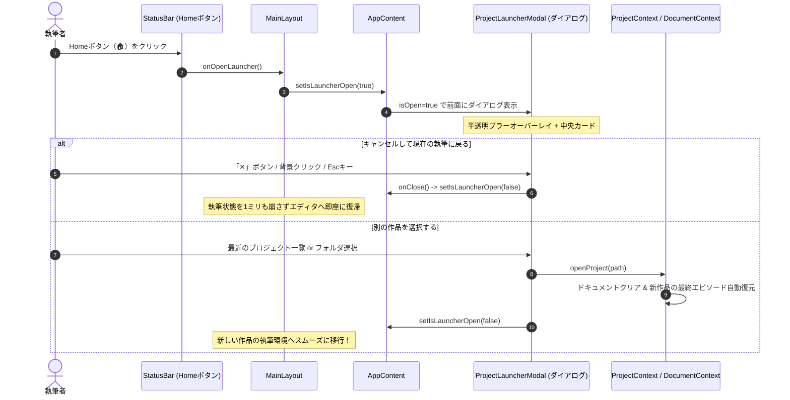

# 【第61回】プロジェクト切替ダイアログの復活とStatusBar連携の修復

こんにちは！ 小説執筆用エディター **`novelaide`**（コードネーム: `novelaid-e`）の開発メイキング連載第61回です。

長編小説の連載や短編の執筆を並行している作家にとって、別の作品（プロジェクトフォルダー）へとワンクリックで切り替えられる機能は欠かせません。
画面最下部のステータスバー左端には、初代 `novelaid-editor` から継承された「Home（作品一覧へ戻る）」アイコンボタンが設置されていました。

しかし今回、「Homeボタンをクリックしても作品一覧が開かず、別プロジェクトを開けない」という致命的な不具合の報告が寄せられました。
調査を進めると、ステータスバーへのイベント伝達漏れという単純なミスに加え、プロジェクトランチャー画面自体の「表示構造」に起因するUXの違和感が浮き彫りになりました。

今回は、この原因究明と、旧作で親しまれていた**ダイアログ風モーダル表示（`ProjectLauncherModal`）への刷新プロセス**をお届けします！

---

## 1. 開発の背景と投げかけたプロンプト

まずはユーザーから寄せられた要望と疑問のプロンプトをご紹介します。

### ユーザー入力プロンプト

> /plan 現在、ステータスバー左下のHomeボタンでの作品一覧表示(切替)が行えません。  
> そのため、別なプロジェクトを開けない状態です。プロジェクト選択のダイアログ表示のさせ方の問題と思われます。元のnovelaid-editorではダイアログ風の表示でしたが、novelaideではドキュメント領域に表示されている？  
> プロジェクトの切り替えが可能なようになる変更を計画してください。

### なぜHomeボタンが動かなかったのか？

コードを追跡したところ、原因は非常にシンプルなものでした。

親レイアウトである `MainLayout.tsx` は、上位の `App.tsx` から `onOpenLauncher` コールバックを正しく受け取っていました。
また、`StatusBar.tsx` 側でもボタンクリック時に `onClick={onOpenLauncher}` を呼び出す準備ができていました。

しかし、なんと `MainLayout.tsx` の最下部にある `<StatusBar ... />` の呼び出し箇所で、**`onOpenLauncher={onOpenLauncher}` props の渡し忘れ**が発生していたのです。
そのため、Homeボタンを押しても関数が `undefined` となり、画面上では何も起きない状態に陥っていました。

さらに、「ドキュメント領域に表示されている？」というユーザーの直感的な違和感には、もう一つの深い理由がありました。

---

## 2. 全画面差し替え vs ダイアログ風モーダル表示

### 従来の全画面差し替え方式の問題点

これまでの `App.tsx` では、プロジェクト選択画面を開く際、以下のような全画面の条件分岐レンダリングを行っていました。

```tsx
// 従来のApp.tsx
if (showLauncher) {
  return <ProjectLauncherPage onNavigateToEditor={() => setShowLauncher(false)} />;
}
return <MainLayout onOpenLauncher={() => setShowLauncher(true)} />;
```

この実装には2つの大きな欠点がありました：
1. **エディタ状態の完全リセット**:
   `MainLayout` を完全にアンマウントしてしまうため、現在開いているタブやサイドバーの開閉状態、エディタのスクロール位置が一度破棄されてしまいます。
2. **「切り替える」感覚の喪失**:
   執筆中に「ちょっと別の作品を参照したい」「別作品に切り替えたい」と思った作家にとって、画面全体が真っ暗に切り替わるのは心理的な断絶を生みます。また、ドキュメントをすべて閉じた時のウェルカム画面とも相まって、「ドキュメント領域にランチャーが埋め込まれている」ような不自然さを感じさせていました。

### 初代 `novelaid-editor` のダイアログUIへの回帰

初代の Electron 版 `novelaid-editor` では、エディタ画面の上に中央カード（`max-width: 700px`、角丸、シャドウ付き、右上に閉じる「✕」ボタン）がフワッと重なる**ダイアログ風のオーバーレイUI**でした。

そこで今回は、共通UIライブラリ `restar-app` の `ProjectLauncher` を内包した **`ProjectLauncherModal`** を新設し、モーダルダイアログとして前面に重ねるアーキテクチャへと刷新しました。



---

## 3. 実装の詳細

### 3.1. `ProjectLauncherModal` コンポーネントの新設

`src/components/Launcher/ProjectLauncherModal.tsx` を新設し、モーダル表示に必要な制御を実装しました。

```typescript
export const ProjectLauncherModal: React.FC<ProjectLauncherModalProps> = ({
  isOpen,
  onClose,
}) => {
  const { projectPath, recentProjects, openProject, removeRecentProject, appVersion } = useProject();

  // Esc キー押下で閉じる（プロジェクト選択中のみ）
  useEffect(() => {
    if (!isOpen || !projectPath) return;

    const handleKeyDown = (e: KeyboardEvent) => {
      if (e.key === "Escape") {
        e.preventDefault();
        onClose?.();
      }
    };

    window.addEventListener("keydown", handleKeyDown);
    return () => window.removeEventListener("keydown", handleKeyDown);
  }, [isOpen, projectPath, onClose]);

  if (!isOpen) return null;

  const isModalMode = !!projectPath;
  const launcherLabels = {
    openFolder: "既存の作品フォルダーを開く",
    createProject: "新しい作品を作成する",
    backButtonTitle: "執筆エディターに戻る (Esc)",
    // ...
  };

  const content = (
    <LibProjectLauncher
      title="novelaide"
      subtitle="作品フォルダー（執筆プロジェクト）を選択してください"
      version={appVersion ? `v${appVersion}` : undefined}
      logoIcon={<Feather size={48} className="launcher-logo" />}
      recentProjects={recentProjects}
      onOpenProject={handleOpenProject}
      onPickDirectory={handlePickDirectory}
      onCreateProject={handleCreateProject}
      onRemoveRecent={removeRecentProject}
      isBackEnabled={isModalMode}
      onBack={onClose}
      labels={launcherLabels}
    />
  );

  // プロジェクト未選択（初回起動時）は全画面、編集中はオーバーレイモーダル
  if (!isModalMode) {
    return <div className="project-launcher-fullscreen">{content}</div>;
  }

  return (
    <div
      className="project-launcher-modal-overlay"
      onClick={(e) => {
        if (e.target === e.currentTarget) onClose?.();
      }}
      role="dialog"
      aria-modal="true"
    >
      {content}
    </div>
  );
};
```

### 3.2. オーバーレイとブラー演出のCSS設計

`ProjectLauncherModal.css` では、エディタの上に美しい半透明ブラー（`backdrop-filter: blur(4px)`）を敷き、カードが中央にスケールインするアニメーションを定義しました。

```css
.project-launcher-modal-overlay {
  position: fixed;
  inset: 0;
  z-index: 9999;
  background-color: rgba(0, 0, 0, 0.65);
  backdrop-filter: blur(4px);
  display: flex;
  align-items: center;
  justify-content: center;
  animation: launcherModalFadeIn 0.18s ease-out;
}

/* モーダル表示時はカードコンテナの背景を透過させてブラーを活かす */
.project-launcher-modal-overlay .launcher-container {
  background-color: transparent !important;
  width: 100% !important;
  height: 100% !important;
}

.project-launcher-modal-overlay .launcher-card {
  box-shadow: 0 16px 48px rgba(0, 0, 0, 0.6), 0 0 0 1px var(--border-color, rgba(255, 255, 255, 0.1));
  animation: launcherCardSlideIn 0.2s cubic-bezier(0.16, 1, 0.3, 1);
}
```

### 3.3. `MainLayout.tsx` と `App.tsx` の接続

`MainLayout.tsx` では、最下部の `<StatusBar />` に `onOpenLauncher={onOpenLauncher}` を確実に渡しました。
そして `App.tsx` では、`MainLayout` をアンマウントせず常駐させ、前面に `ProjectLauncherModal` を重ねるシンプルな宣言的構成にリファクタリングしました。

```tsx
function AppContent() {
  const { projectPath } = useProject();
  const [isLauncherOpen, setIsLauncherOpen] = useState<boolean>(!projectPath);

  const isModalVisible = isLauncherOpen || !projectPath;

  return (
    <>
      {projectPath && (
        <MainLayout onOpenLauncher={() => setIsLauncherOpen(true)} />
      )}
      <ProjectLauncherModal
        isOpen={isModalVisible}
        onClose={() => {
          if (projectPath) {
            setIsLauncherOpen(false);
          }
        }}
      />
    </>
  );
}
```

---

## 4. まとめと次回予告

今回の修復とUI刷新によって、長年の課題だったプロジェクト切替体験が劇的に改善されました。

- **ステータスバー左下のHomeボタンから作品一覧が即座に開く**
- **エディタ画面の上にフワッと重なる美しいダイアログ風モーダル表示**
- **「✕」ボタン・背景クリック・`Esc` キーによるストレスフリーな執筆復帰**
- **別作品の選択時はドキュメントが安全にクリアされ、新作品の最終エピソードを自動再開**

小さなイベントハンドラの渡し忘れをきっかけに、アプリ全体の画面遷移構造を見直し、作家が安心して複数作品を行き来できる堅牢で美しいUIへと進化させることができました。

次回も、小説執筆に寄り添う快適な機能改善と、開発の舞台裏を詳しくお届けします。どうぞお楽しみに！
