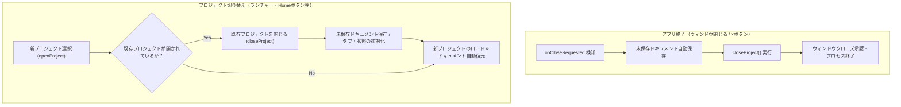

# 第62回：プロジェクト切替とアプリ終了時のライフサイクル管理

## はじめに

執筆エディターを快適に使い続ける上で欠かせないのが、**「作品を切り替えるとき」や「アプリを終了するとき」の安全なライフサイクル管理**です。

前回の第61回では、ステータスバーのホームボタンから作品選択ランチャーを美しいモーダルダイアログとして呼び出せるようにしました。しかし、実際に別な作品を選んでプロジェクトを切り替えてみると、重大な問題に直面しました。

**「新しく開いたプロジェクトの裏に、前のプロジェクトで開いていたドキュメントタブがそのまま残ってしまっている……！」**

さらに調べてみると、アプリのウィンドウ右上の「×」ボタンを押して閉じる際にも、未保存ドキュメントの自動保存やプロジェクトのクローズ処理が行われずにプロセスが直ちに終了してしまう状態であることが判明しました。

今回は、小説執筆エディター `novelaide` における**プロジェクト切替時およびアプリ終了時のライフサイクル設計と、ドキュメントの安全な自動保存・破棄フロー**を徹底実装しました。

---

## 1. なぜ前のプロジェクトのドキュメントが残っていたのか？

旧作（Electron版 `novelaid-editor`）と今作のコードを突き合わせて調査したところ、以下の2つの大きな要因が浮かび上がりました。

### 要因1：プロジェクト切替時にクローズ処理を挟んでいなかった
旧作では、新しいプロジェクトを開く `loadProject()` の冒頭で、必ず `closeProject()` を明示的に呼び出して現在のプロジェクト状態とドキュメント一覧を一旦ゼロにリセットしていました。
しかし今作の `ProjectContext.openProject()` では、単に `setProjectPath(newPath)` で新しいパスを上書きするだけで、旧プロジェクトを閉じるライフサイクルが存在していませんでした。

### 要因2：React 非同期ステート更新と自動復元のタイミング競合
`DocumentContext` 側では、`currentProjectPath` の変更を検知して `setOpenDocuments([])` を呼ぶ `useEffect` が設置されていました。
しかし、React の `useState` によるステート更新は非同期です。そのため、新プロジェクトへの切替直後、別な `useEffect`（最後に開いていた小説ファイルを自動復元する処理）が走った瞬間には、Ref（`openDocumentsRef.current`）の中に**まだ前のプロジェクトのドキュメント配列が残っており**、「すでにドキュメントが開かれている」と誤判定されて自動復元がスキップされたり、タブ配列が競合して残存してしまっていました。

---

## 2. ライフサイクルの全体設計

プロジェクト切替時とアプリ終了時のそれぞれについて、未保存ドキュメントの安全な保存とクリーンアップを保証する直列フローを設計しました。



---

## 3. 実装のポイント

### 3.1 `ProjectContext` の非同期クローズとハンドラ登録
コンテキスト階層上、`ProjectProvider` は `DocumentProvider` の外側に配置されています。そのため、`ProjectContext` が `DocumentContext` の内部関数を直接呼び出すことはできません。
そこで、React の階層を保ったまま外部からクローズ処理をフックできる `registerCloseHandler` パターンを導入しました。

```typescript
// src/contexts/ProjectContext.tsx
const closeHandlerRef = useRef<(() => Promise<void> | void) | null>(null);

const registerCloseHandler = useCallback((handler: (() => Promise<void> | void) | null) => {
  closeHandlerRef.current = handler;
}, []);

// プロジェクトを閉じる（ランチャーへ戻る）
const closeProject = useCallback(async () => {
  bootLog("closeProject called");
  if (closeHandlerRef.current) {
    try {
      await closeHandlerRef.current();
    } catch (err) {
      console.error("Failed to execute closeHandler in closeProject:", err);
    }
  }
  setProjectPath(null);
  setProjectName(null);
  localStorage.removeItem(CURRENT_PROJECT_KEY);
}, []);

// プロジェクトを開く（既存プロジェクトがあれば事前に閉じる）
const openProject = useCallback(
  async (path: string, customName?: string) => {
    bootLog("openProject called:", { path, customName, currentProjectPath: projectPath });
    if (projectPath && projectPath !== path) {
      await closeProject();
    }
    const parts = path.split(/[\\/]/).filter(Boolean);
    const name = customName || parts[parts.length - 1] || "Untitled";

    setProjectPath(path);
    setProjectName(name);
    localStorage.setItem(CURRENT_PROJECT_KEY, path);

    await addRecentProject(name, path);
  },
  [projectPath, closeProject]
);
```

### 3.2 `DocumentContext` の `closeAllDocuments` と同期クリア
`DocumentContext` 側では、未保存ドキュメント（`isDirty === true`）を安全にすべてファイル保存してからタブ・ペイン状態を初期化する `closeAllDocuments` を実装し、`registerCloseHandler` に登録しました。

```typescript
// src/contexts/DocumentContext.tsx
// 全ドキュメントを閉じる（プロジェクト切替やアプリ終了時に使用）
const closeAllDocuments = useCallback(
  async (options?: { saveDirty?: boolean }) => {
    console.log('[DocumentContext] closeAllDocuments called', options);
    if (options?.saveDirty !== false) {
      const dirtyDocs = openDocumentsRef.current.filter((d) => d.isDirty);
      for (const doc of dirtyDocs) {
        clearAutoSaveTimer(doc.path);
        try {
          await saveDocument(doc.path);
        } catch (e) {
          console.error(`[DocumentContext] Failed to save dirty doc on closeAll: ${doc.path}`, e);
        }
      }
    }

    // 自動保存タイマーの全クリア
    Object.keys(autoSaveTimersRef.current).forEach((p) => {
      clearTimeout(autoSaveTimersRef.current[p]);
    });
    autoSaveTimersRef.current = {};

    openDocumentsRef.current = [];
    setOpenDocuments([]);
    setActivePathByPane({
      'editor.left': null,
      'editor.right': null,
    });
    setIsSplit(false);
    setActivePane('editor.left');
  },
  [clearAutoSaveTimer, saveDocument]
);

// ProjectContext のクローズハンドラに自身を登録
useEffect(() => {
  if (registerCloseHandler) {
    registerCloseHandler(async () => {
      await closeAllDocuments({ saveDirty: true });
    });
  }
  return () => {
    if (registerCloseHandler) {
      registerCloseHandler(null);
    }
  };
}, [registerCloseHandler, closeAllDocuments]);
```

さらに、プロジェクトパス変更監視の `useEffect` でも `openDocumentsRef.current = []` と自動復元フラグのリセットを同期的に実行することで、新プロジェクトのファイル自動復元が確実にトリガーされるようにしました。

### 3.3 アプリ終了ハンドラ（`useWindowCloseHandler`）の導入
Tauri 2.x の `@tauri-apps/api/window` から `getCurrentWindow().onCloseRequested` を利用し、ウィンドウ終了イベントをインターセプトする専用フックを作成しました。

```typescript
// src/hooks/useWindowCloseHandler.ts
export const useWindowCloseHandler = () => {
  const { closeProject } = useProject();
  const isClosingRef = useRef(false);

  useEffect(() => {
    let unlisten: (() => void) | undefined;

    const setupTauriCloseHandler = async () => {
      try {
        const appWindow = getCurrentWindow();
        unlisten = await appWindow.onCloseRequested(async (event) => {
          bootLog("[useWindowCloseHandler] onCloseRequested triggered");
          if (isClosingRef.current) {
            return;
          }
          // 即時のウィンドウ破棄を抑止
          event.preventDefault();
          isClosingRef.current = true;

          try {
            // プロジェクトクローズ（未保存ドキュメントの自動保存とクリーンアップ）
            await closeProject();
          } catch (err) {
            console.error("[useWindowCloseHandler] Failed during closeProject on exit:", err);
          } finally {
            try {
              // クリーンアップ完了後にウィンドウを破棄
              await appWindow.destroy();
            } catch (destroyErr) {
              console.error("[useWindowCloseHandler] Failed to destroy window:", destroyErr);
            }
          }
        });
      } catch (e) {
        console.warn("[useWindowCloseHandler] Could not register Tauri onCloseRequested:", e);
      }
    };

    setupTauriCloseHandler();

    // Web環境やブラウザリロード対策
    const handleBeforeUnload = () => {
      closeProject();
    };
    window.addEventListener("beforeunload", handleBeforeUnload);

    return () => {
      if (unlisten) unlisten();
      window.removeEventListener("beforeunload", handleBeforeUnload);
    };
  }, [closeProject]);
};
```

---

## 4. 動作確認

実装後、以下の動作を検証しました。
1. **プロジェクト切替の検証**:
   - プロジェクトAで執筆ドキュメントを開き、一部編集した未保存の状態で、StatusBar の Home ボタンからプロジェクトBを選択。
   - プロジェクトAの内容が自動保存され、タブが完全に消去された後、プロジェクトBの直近の原稿ファイルが綺麗に開かれることを確認。
2. **ウィンドウクローズの検証**:
   - 原稿を編集中の状態でウィンドウ右上の「×」ボタンを押下。
   - `onCloseRequested` がフックされ、保存処理とプロジェクトクローズが実行された上で安全にウィンドウが終了することを確認。

---

## 5. まとめと次回予告

プロジェクト切替時とアプリ終了時という、エディターにとって最も基本的かつクリティカルなライフサイクルが整ったことで、原稿データの消失や別プロジェクトとの混同といったリスクが根本から解消されました。

次回は、エディター機能のさらなるブラッシュアップや、執筆支援機能の強化を進めていきます！
