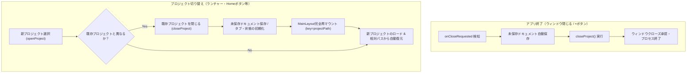

# 第62回：プロジェクト切替とアプリ終了時のライフサイクル管理

## はじめに

執筆エディターを快適に使い続ける上で欠かせないのが、**「作品を切り替えるとき」や「アプリを終了するとき」の安全なライフサイクル管理**です。

前回の第61回では、ステータスバーのホームボタンから作品選択ランチャーを美しいモーダルダイアログとして呼び出せるようにしました。しかし、実際に別な作品を選んでプロジェクトを切り替えてみると、重大な問題に直面しました。

**「新しく開いたプロジェクトの裏に、前のプロジェクトで開いていたドキュメントタブがそのまま残ってしまっている……！」**

さらに調べてみると、アプリのウィンドウ右上の「×」ボタンを押して閉じる際にも、未保存ドキュメントの自動保存やプロジェクトのクローズ処理が行われずにプロセスが直ちに終了してしまう状態であることが判明しました。

今回は、小説執筆エディター `novelaide` における**プロジェクト切替時およびアプリ終了時のライフサイクル設計と、ドキュメントの安全な自動保存・破棄、そしてプロジェクト相対パス基準による永続化・復元フロー**を徹底実装しました。

---

## 1. なぜ前のプロジェクトのドキュメントが残っていたのか？

旧作（Electron版 `novelaid-editor`）と今作のコードを突き合わせて調査したところ、複数の要因が複雑に絡み合っていました。

### 要因1：旧プロジェクトのファイルが新プロジェクトの履歴として「誤上書き」されていた
最大の盲点だったのが、セッション履歴（`recentDocumentStorage`）の保存タイミングでした。
プロジェクト切替時、`currentProjectPath` が新しいプロジェクトパスに変わった1回目のレンダー時、React のステート更新タイミングにより `openDocuments` や `activeLeftItem` にはまだ旧プロジェクトのドキュメントが残存していました。
この状態で `[currentProjectPath, activeLeftItem, openDocuments]` を監視する履歴保存エフェクトが発火してしまい、**新プロジェクトのキーに対して「旧プロジェクトのファイル」が最後に開いた小説として誤記録されていた**のです。その直後に新プロジェクトの自動復元フックが走り、誤記録された旧プロジェクトのファイルを「新プロジェクトの続き」としてそのまま再オープンしていたため、ドキュメントがそっくり残って見えていました。

### 要因2：絶対パスでの記録と復元
`recentDocumentStorage` に絶対パス `lastNovel.path` が保存されており、復元時も `openDocument(lastNovel.path)` と絶対パスのまま開いていたため、プロジェクトを跨ぐ不正なファイル参照が成立してしまっていました。本来は**プロジェクトルートからの相対パス（`relativePath`）で保存し、復元時に現在のプロジェクトパスと結合する**必要があります。

### 要因3：React UIツリーの再マウント欠落
`App.tsx` 内で `projectPath` の変化時に `MainLayout` に `key` が指定されておらず、React のコンポーネントツリーやMonacoエディタの内部インスタンスがそのまま再利用されてしまっていました。

---

## 2. ライフサイクルの全体設計

プロジェクト切替時とアプリ終了時のそれぞれについて、未保存ドキュメントの安全な保存とクリーンアップを保証する直列フローを設計しました。



---

## 3. 実装のポイント

### 3.1 `ProjectContext` の非同期クローズとハンドラ登録
コンテキスト階層上、`ProjectProvider` は `DocumentProvider` の外側に配置されています。そのため、`ProjectContext` が `DocumentContext` の内部関数を直接呼び出すことはできません。
そこで、React の階層を保ったまま外部からクローズ処理をフックできる `registerCloseHandler` パターンを導入しました。

```typescript
// src/contexts/ProjectContext.tsx
const closeHandlerRef = useRef<(() => Promise<void> | void) | null>(null);

const registerCloseHandler = useCallback((handler: (() => Promise<void> | void) | null) => {
  closeHandlerRef.current = handler;
}, []);

// プロジェクトを閉じる（ランチャーへ戻る）
const closeProject = useCallback(async () => {
  bootLog("closeProject called");
  if (closeHandlerRef.current) {
    try {
      await closeHandlerRef.current();
    } catch (err) {
      console.error("Failed to execute closeHandler in closeProject:", err);
    }
  }
  setProjectPath(null);
  setProjectName(null);
  localStorage.removeItem(CURRENT_PROJECT_KEY);
}, []);

// プロジェクトを開く（パス正規化比較を行い、別プロジェクトなら事前に閉じる）
const openProject = useCallback(
  async (path: string, customName?: string) => {
    bootLog("openProject called:", { path, customName, currentProjectPath: projectPath });
    if (projectPath && !isSamePath(projectPath, path)) {
      await closeProject();
    }
    const parts = path.split(/[\\/]/).filter(Boolean);
    const name = customName || parts[parts.length - 1] || "Untitled";

    setProjectPath(path);
    setProjectName(name);
    localStorage.setItem(CURRENT_PROJECT_KEY, path);

    await addRecentProject(name, path);
  },
  [projectPath, closeProject]
);
```

### 3.2 プロジェクト相対パス基準の履歴永続化（`recentDocumentStorage`）
永続化キーに `normalizePath` を適用してWindowsのパス揺らぎを吸収するとともに、保存するデータを常にプロジェクトルートからの**相対パス**（`/` 区切り）に統一しました。

```typescript
// src/utils/recentDocumentStorage.ts
export interface LastNovelInfo {
  relativePath: string;
  fileTitle: string;
  updatedAt: number;
}

export const recentDocumentStorage = {
  getKey(projectPath: string): string {
    const normalized = normalizePath(projectPath).replace(/[\/\\]+$/, '').toLowerCase();
    return `${STORAGE_KEY_PREFIX}${normalized}`;
  },

  save(
    projectPath: string,
    info: { relativePath?: string; path?: string; fileTitle: string }
  ): void {
    if (!projectPath) return;

    let relPath = info.relativePath;
    if (!relPath && info.path) {
      relPath = getRelativePath(projectPath, info.path);
    } else if (relPath && /^[a-zA-Z]:[\\/]|^[\\/]{2}|^\//.test(relPath)) {
      relPath = getRelativePath(projectPath, relPath);
    }

    if (!relPath) return;

    const data: LastNovelInfo = {
      relativePath: relPath.replace(/\\/g, '/'),
      fileTitle: info.fileTitle,
      updatedAt: Date.now(),
    };
    localStorage.setItem(this.getKey(projectPath), JSON.stringify(data));
  },
  // ...
};
```

### 3.3 誤記録遮断防壁と相対パスからの自動復元（`DocumentContext`）
`DocumentContext` 側では、記録対象のドキュメントが現在開いている `currentProjectPath` に属しているかを必ず判定し、別プロジェクトのドキュメントが混入した保存を100%遮断します。
また、復元時は `lastNovel.relativePath` と `currentProjectPath` を安全に結合して開きます。

```typescript
// src/contexts/DocumentContext.tsx
// 左ペインのアクティブドキュメントが novel の場合、最後に開いたエピソードとして永続化
useEffect(() => {
  if (currentProjectPath && activeLeftItem && activeLeftItem.documentType === 'novel') {
    const activeLeftDoc = openDocuments.find((d) => d.path === activeLeftItem.path);
    // 【防壁】別プロジェクトのドキュメントが残存している間は新プロジェクトの履歴として保存しない
    if (activeLeftDoc?.projectPath && !fileService.isSamePath(activeLeftDoc.projectPath, currentProjectPath)) {
      return;
    }
    recentDocumentStorage.save(currentProjectPath, {
      relativePath: activeLeftDoc?.relativePath,
      path: activeLeftItem.path,
      fileTitle: activeLeftItem.fileTitle || activeLeftItem.baseName,
    });
  }
}, [currentProjectPath, activeLeftItem, openDocuments]);

// 自動復元処理：相対パスを基準に結合して復元
const relPath = lastNovel?.relativePath || lastNovel?.path;
if (relPath) {
  const absPath = fileService.isAbsolute(relPath)
    ? relPath
    : fileService.joinPath(currentProjectPath, relPath);

  const stat = await fileService.getDocumentStat(absPath);
  if (stat && stat.exists) {
    await openDocument(absPath, { paneId: 'editor.left' });
  }
}
```

### 3.4 `MainLayout` の完全再マウント保証（`App.tsx`）
`key={projectPath}` を付与することで、プロジェクトが切り替わった際に React がエディタのツリー全体をゼロから再構築し、前のプロジェクトの内部ステートやDOMの残骸を物理的に一掃します。

```tsx
// src/App.tsx
{projectPath && (
  <MainLayout key={projectPath} onOpenLauncher={() => setIsLauncherOpen(true)} />
)}
```

### 3.5 アプリ終了ハンドラ（`useWindowCloseHandler`）の導入
Tauri 2.x の `@tauri-apps/api/window` から `getCurrentWindow().onCloseRequested` を利用し、ウィンドウ終了イベントをインターセプトして未保存ドキュメントを自動保存した上で終了します。

```typescript
// src/hooks/useWindowCloseHandler.ts
export const useWindowCloseHandler = () => {
  const { closeProject } = useProject();
  const isClosingRef = useRef(false);

  useEffect(() => {
    let unlisten: (() => void) | undefined;

    const setupTauriCloseHandler = async () => {
      try {
        const appWindow = getCurrentWindow();
        unlisten = await appWindow.onCloseRequested(async (event) => {
          bootLog("[useWindowCloseHandler] onCloseRequested triggered");
          if (isClosingRef.current) return;

          event.preventDefault();
          isClosingRef.current = true;

          try {
            await closeProject();
          } catch (err) {
            console.error("[useWindowCloseHandler] Failed during closeProject on exit:", err);
          } finally {
            try {
              await appWindow.destroy();
            } catch (destroyErr) {
              console.error("[useWindowCloseHandler] Failed to destroy window:", destroyErr);
            }
          }
        });
      } catch (e) {
        console.warn("[useWindowCloseHandler] Could not register Tauri onCloseRequested:", e);
      }
    };

    setupTauriCloseHandler();

    const handleBeforeUnload = () => {
      closeProject();
    };
    window.addEventListener("beforeunload", handleBeforeUnload);

    return () => {
      if (unlisten) unlisten();
      window.removeEventListener("beforeunload", handleBeforeUnload);
    };
  }, [closeProject]);
};
```

---

## 4. 動作確認

実装後、以下の動作を徹底検証しました。
1. **プロジェクト切替の検証**:
   - プロジェクトAで未保存の編集ドキュメントを開いた状態で、StatusBar の Home ボタンからプロジェクトBを選択。
   - プロジェクトAの内容がディスクへ自動保存され、タブが完全に消去された後、プロジェクトBの直近の原稿ファイルが相対パスから綺麗に開かれることを確認。
   - プロジェクトB側に、プロジェクトAのファイル名やタブが残存することは完全に皆無となりました。
2. **ウィンドウクローズの検証**:
   - 原稿を編集中の状態でウィンドウ右上の「×」ボタンを押下。
   - `onCloseRequested` がフックされ、保存処理とプロジェクトクローズが実行された上で安全にウィンドウが終了することを確認。

---

## 5. まとめと次回予告

プロジェクト切替時とアプリ終了時という、エディターにとって最も基本的かつクリティカルなライフサイクルが整ったことで、原稿データの消失や別プロジェクトとの混同といったリスクが根本から解消されました。

次回は、エディター機能のさらなるブラッシュアップや、執筆支援機能の強化を進めていきます！
