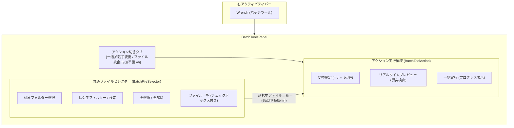

# 第63回：バッチ処理ツール基盤と一括拡張子変更機能の実装

## はじめに

小説執筆プロジェクトを長年続けていると、**「既存の原稿ファイルの拡張子を一括で変換したい」**という場面に出くわすことがあります。

例えば、これまで Markdown（`.md`）として執筆していた作品を、`novelaide` における標準的な小説原稿形式である Plain Text（`.txt`）へ移行したい場合や、逆に外部ツール連携のためにテキスト形式を Markdown に統一したい場合などです。

1ファイルずつ名前を変更するのは骨が折れますし、日常的なファイルエクスプローラーのコンテキストメニューに置くには利用頻度（プロジェクト移行時など単発）が高くありません。

そこで今回は、将来的な「章フォルダーごとの複数ファイル統合出力（テキスト/PDF結合）」などの一括処理も見据え、**「共通選択UI ＋ 処理アクションのプラグイン化」による堅牢なバッチ処理ツール基盤（`BatchToolsPanel`）**を右サイドバーに実装しました。

---

## 1. アーキテクチャの検討：なぜ右サイドバーなのか？

バッチ処理ツールのUI配置を検討するにあたり、以下の理由から**右サイドバー（`defaultPlacement: 'right'`）**を採用しました。

1. **左側のファイルツリーを見ながら並行操作できる**:
   - 左ペインで原稿フォルダーの構造やファイル配置を確認しながら、右ペインで対象フォルダーの選択やプレビューを確認できるため、視線の流れと作業動線が極めて自然になります。
2. **ナビゲーションとツールの責務分離**:
   - `novelaide` では、左側にエクスプローラー・検索・Gitなどの「原稿ナビゲーション」、右側にAI執筆パートナー・文章校正などの「ツール・支援系」が配置されています。バッチ処理も「執筆支援ツール」の一環であるため、右側に配置することで直感的な統一感が生まれます。
3. **左右自在な移動対応**:
   - `allowedPlacements: ['left', 'right']` としておくことで、ユーザーの好みで左ペインに移動させることも可能です。



---

## 2. 共通ファイルセレクター（`BatchFileSelector`）の設計

一括処理ツールごとに毎回ファイル選択UIを作り直すのは無駄が多く、操作感もバラバラになってしまいます。
そこで、**「フォルダー選択・拡張子フィルター・除外チェックボックス」を1つの共通コンポーネント（`BatchFileSelector`）として独立**させました。

- **フォルダー選択**: プロジェクトルート全体または各サブフォルダーを選択可能。
- **拡張子自動収集**: 選択フォルダー内に存在する拡張子（`.md` や `.txt`）を自動検出し、ワンタッチで絞り込み。
- **除外チェックボックス**: 「全選択」した上で、「このファイルだけは変更したくない」というファイルを1クリックで除外可能。

---

## 3. 拡張子一括変更アクション（`BatchExtensionChanger`）の実装

今回の中核機能である拡張子の一括リネームアクションです。

### 3.1 プリセットとプレビュー
- `[.md → .txt]` および `[.txt → .md]` のワンタッチプリセットボタンを設置。
- 変換前ファイル名 → 変換後ファイル名のリアルタイムプレビューを表示。

### 3.2 安全なリネームとエディター連動
ディスク上のファイルを変更するだけでは、現在エディタータブで開いているファイルとの整合性が崩れてしまいます。
そのため、以下の直列フローで安全に実行します：

1. **未保存ドキュメントの事前保存**: 開いているドキュメントに対象ファイルがあれば、リネーム前に自動保存。
2. **`fileService.rename` の実行**: ディスク上のファイル名を変更。
3. **タブのパス追従**: `DocumentContext.updateDocumentPath` を呼び出し、開いているエディタータブのパスと表示名を同期。
4. **ツリー更新イベント**: `novelaide:project-refresh-needed` を発行して左側のエクスプローラーを最新状態に更新。

```typescript
// 順次リネーム実行
for (let i = 0; i < previewItems.length; i++) {
  const item = previewItems[i];
  setProgress({ current: i + 1, total: previewItems.length });

  try {
    await fileService.rename(item.originalFile.path, item.newPath);
    // 開いているタブがあればパスを同期更新
    updateDocumentPath(item.originalFile.path, item.newPath);
    successCount++;
  } catch (err: any) {
    console.error(`[BatchExtensionChanger] Rename error:`, err);
    failCount++;
  }
}
window.dispatchEvent(new CustomEvent('novelaide:project-refresh-needed'));
```

---

## 4. 将来の拡張性：ファイル統合出力（Concatenator）

本アーキテクチャにより、将来「ファイル統合出力」を導入する際も、共通セレクターをそのまま使い回し、以下のようなアクションコンポーネントを差し込むだけで完結します：

- 章フォルダー内の複数エピソードを、タイトル見出し付きで1本のテキストに結合。
- 改ページや区切り記号の自動挿入。
- PDFやEPUBなどへの出力変換。

---

## 5. まとめ

単機能の拡張子変更ツールにとどまらず、将来のファイル結合エクスポートや一括処理を見据えた拡張基盤として整備したことで、`novelaide` にまた1つ強力な小説執筆・管理機能が加わりました！
