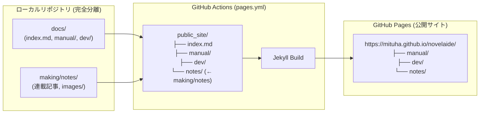

# 第64回：GitHub Pagesによる公式ドキュメント公開と自動キャプチャー基盤の整備

小説執筆用デスクトップIDE **`novelaide`**（コードネーム: `novelaid-e`）の開発メイキング連載第64回です。

今回は、執筆者向けのユーザーマニュアルや開発者仕様書を **GitHub Pages でWebサイトとして公開** する仕組みと、アプリ内からの閲覧導線、そしてマニュアルの視覚的理解を助ける **Playwright によるスクリーンショット自動キャプチャー環境の整備** について解説します。

---

## 1. 課題と背景

先行の `novelaid-editor` では、GitHub Pages を通じてユーザーマニュアルや開発資料をWeb上で公開していました。`novelaide` でも同様にWeb公開を行う必要がありましたが、以下の2つの大きな課題がありました。

1. **コンテキスト分離ルールとの両立**:
   本プロジェクトでは、「`docs/`（公開ドキュメント）」と「`making/`（システム開発・運用の記録）」を物理的に完全に分離する運用ルールを定めています。note.com に連載しているメイキング記事（`making/notes/`）もWeb公開したいものの、ファイルを `docs/` 配下へ移動させてしまうと、日々の作業ログやAIスキルの動作基盤が崩れてしまいます。
2. **マニュアルの視覚化とキャプチャー更新コスト**:
   機能追加のたびにマニュアルのスクリーンショットを手動で撮り直すのは膨大な手間がかかります。継続的かつ自動的に最新のUIをキャプチャーできる環境が不可欠でした。

---

## 2. GitHub Actions による動的マージデプロイ

### 2.1 ローカルの配置は変えずにWeb上で一体公開
GitHub Pages の標準機能（リポジトリのブランチ直結）では、指定したディレクトリ外のファイル（`making/notes/` など）を参照することができません。

そこで、**GitHub Actions による GitHub Pages デプロイ（`.github/workflows/pages.yml`）** を採用しました。
CI ワークフローの実行時に一時ディレクトリ `public_site/` を作成し、そこに `docs/` と `making/notes/` を動的にマージしてから Jekyll ビルドを行います。

これにより、**リポジトリ内のディレクトリ構造やコンテキスト分離ルールを一切崩すことなく**、Web上では `https://mituha.github.io/novelaide/notes/` としてメイキング連載記事をシームレスに公開できるようになりました。

---

## 3. アプリ内からのドキュメント閲覧導線

ユーザーが執筆中にいつでもマニュアルを参照できるよう、アプリ内にWebマニュアルへのリンクを配置しました。

1. **左アクティビティバー最下部（ヘルプアイコン）**:
   テーマ切り替えボタンや環境設定ボタンの並びに `HelpCircle` アイコンを設置。クリック時に `@tauri-apps/plugin-opener` を通じて外部ブラウザで公式Webマニュアル（`https://mituha.github.io/novelaide/manual/`）をワンクリックで開けます。
2. **環境設定「全般・更新」タブ**:
   「公式ドキュメント・関連リンク」セクションを新設し、「Webマニュアル」「メイキング連載」「最新リリース」の外部リンクボタンを配置しました。

---

## 4. Playwright によるスクリーンショット自動生成の高速化

既存の `scripts/capture-screenshots.js` を見直し、以下の最適化を行いました：

- **ダークテーマ特化による高速化**:
  ライト・セピアの撮影ループを省き、ダークテーマのみに限定することで、撮影所要時間を大幅に短縮。
- **バッチ処理ツールの自動撮影追加**:
  前回新設したバッチ処理ツール（`BatchToolsPanel`）を自動展開してキャプチャーし、`docs/manual/images/18_バッチ処理ツール_ダークモード.png` を生成。
- **マニュアル本文への自動埋め込み**:
  `docs/manual/バッチ処理ツールの使い方.md` に画像を配置し、操作手順の視覚的理解を向上させました。
- **npm スクリプトの整備**:
  `npm run capture:screenshots` を実行するだけで、全主要機能のダークモードスクリーンショットが自動生成されます。

---

## 5. サイトUXの向上：ダークテーマ対応・パンくずナビ・マニュアル目次

公開サイトの閲覧体験を高めるため、以下の改善を実施しました：

1. **ユーザーマニュアル総合目次 (`docs/manual/index.md`)**:
   全17本のマニュアルを5大カテゴリに体系化し、`/manual/` で分かりやすく表示。
2. **ダークテーマ対応 & 手動トグル切替**:
   Cayman テーマを拡張し、OSのダークモード設定への自動追従と、ページ右上のトグルボタン（🌙/☀️）による手動切り替え（`localStorage` 保持）を導入。GitHub Dark 風のシックな配色で長文読書でも目が疲れない環境を実現。
3. **階層移動パンくずリンク**:
   全マニュアル・仕様書の上部・下部に上位目次とトップポータルへの戻るリンクを設置し、ヘッダーに共通ナビバーを配備。
4. **`README.md` の公式Web案内**:
   リポジトリ訪問者がワンクリックでWebマニュアルや最新版リリースにアクセスできるようにバッジとリンクを配置。
5. **マニュアルの読者層純化**:
   `開発環境の起動手順` は開発者向け（`docs/dev/`）へ移管し、一般読者向けに `ダウンロードとインストールの手順`（インストーラー入手、SmartScreen対応、初回起動）を新設。
6. **Mermaid ダイアグラムの自動描画**:
   Jekyll では標準描画されない Mermaid コードブロックを、Mermaid.js CDN 連携により SVG ダイアグラムとして自動描画。ダーク／ライトテーマ切り替えにも連動。

---

## 6. まとめ

* **GitHub Pages 総合ポータルの新設**: Cayman テーマを用いた美しいドキュメントサイトを開設。
* **動的マージアーキテクチャ**: コンテキスト分離ルールを守ったまま、メイキング連載をWeb公開。
* **アプリ内連携と自動撮影**: いつでもマニュアルを引ける導線と、マニュアルを継続的に自動生成できる開発環境が完成しました。
* **ダークテーマと快適な回遊性**: 閲覧者が快適に読み進められるモダンなWebドキュメント基盤が整いました。
