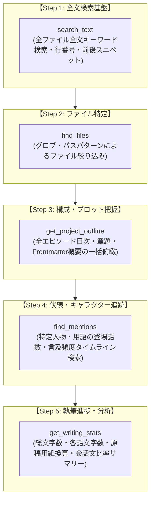

# MCP外部制御仕様書

## 1. 概要

本ドキュメントは、`novelaide`（および関連アプリケーション）を外部のAIエージェントや開発環境から操作可能とする MCP (Model Context Protocol) サーバー機能および外部制御（External Control）統合仕様について規定します。

外部連携（MCP）と内部連携（Pi SDK による内蔵チャット）の双方が同一のツールセットと権限モデルを共有し、エディターの未保存バッファ状態を損なうことなく安全に執筆・編集作業を支援します。

---

## 2. アーキテクチャ

```
+-----------------------------------------------------------------------------------+
| 外部 AI クライアント (Claude Desktop / Cursor / Goose / Cline)                      |
+-----------------------------------------------------------------------------------+
       | HTTP SSE (GET /sse) / JSON-RPC (POST /message?sessionId=...)
       v
+-----------------------------------------------------------------------------------+
| Rust プラグイン (tauri-plugin-novelaid-mcp)                                        |
|  - Tokio TcpListener (公式 MCP SSE トランスポート)                                 |
|  - JSON-RPC 2.0 ディスパッチャ (initialize, tools/list, tools/call)                |
|  - 権限ガード (ReadOnly / ReadWrite チェック)                                      |
+-----------------------------------------------------------------------------------+
       | Tauri イベント ('mcp://tool-call') / コマンド ('respond_tool_call')
       v
+-----------------------------------------------------------------------------------+
| フロントエンド統合層 (ExternalControlService)                                      |
|  - 共通ツール定義 (NOVELAID_TOOLS)                                                |
|  - 統一ディスパッチャ (executeTool)                                                |
|  - 権限制御 (ReadOnlyモード時の書込拒否)                                          |
+-----------------------------------------------------------------------------------+
       | 呼出 (内部 AI / 外部 MCP 共通)
       +--------------------------------------------+
       |                                            |
       v                                            v
+-----------------------------+      +----------------------------------------------+
| エディターバッファ & FS      |      | 各種プラグイン                               |
| - DocumentContext           |      | - 校正: tauri-plugin-novelaid-calibration     |
| - FileService               |      | - ルビ: tauri-plugin-novelaid-ruby            |
|                             |      | - メタデータ: tauri-plugin-novelaid-metadata  |
+-----------------------------+      +----------------------------------------------+
```

---

## 3. 権限モデル

### 3.1 権限レベル（McpPermissionLevel）
- **`ReadOnly`（読み取り専用）**:
  - `read_file`, `list_files`, `scan_proofread`, `extract_ruby`, `search_metadata` のみ実行可能。
  - `write_file`, `edit_file` 等の破壊的操作は拒否（JSON-RPC エラーコード `-32001 Permission denied`）。
- **`ReadWrite`（読み書き可能）**:
  - 全てのツールが実行可能。

### 3.2 二重保護
1. **Rust 層**: `server.rs` 内でツール要求受信時、設定が `ReadOnly` であり要求ツールが書き込み系である場合、即座に拒否レスポンスを返却。
2. **フロントエンド層**: `externalControlService.ts` 内でも二重チェックを行い、意図しない破壊的変更を完全に防止。

---

## 4. ツール仕様一覧

1. **`read_file`** (Read)
   - 引数: `path` (string)
   - 挙動: 現在エディターで開いており未保存バッファが存在する場合はその最新内容を返却。開かれていない場合はファイルシステム（`tauri-plugin-novelaid-fs`）から読み取り返却。
2. **`write_file`** (Write)
   - 引数: `path` (string), `content` (string)
   - 挙動: ファイルシステムに書き込み、現在エディターで開かれている場合はバッファの内容も最新化。
3. **`edit_file`** (Write)
   - 引数: `path` (string), `old_string` (string), `new_string` (string)
   - 挙動: ファイル内の特定テキストを置換。
4. **`list_files`** (Read)
   - 引数: `path` (string, optional)
   - 挙動: ディレクトリ内のファイル・フォルダ一覧を取得。
5. **`scan_proofread`** (Read)
   - 引数: `text` (string, optional), `path` (string, optional)
   - 挙動: Lindera 形態素解析による日本語文章校正（重複助詞、ら抜き言葉、二重否定等）を実行。
6. **`extract_ruby`** (Read)
   - 引数: `text` (string, optional), `path` (string, optional)
   - 挙動: 青空文庫形式ルビの抽出と解析結果を取得。
7. **`search_metadata`** (Read)
   - 引数: `query` (string), `category` (string, optional)
   - 挙動: 人名・地名・組織などのプロジェクト内メタデータを前方一致検索。
8. **`search_text`** (Read)
   - 引数: `query` (string, 必須), `path_filter` (string, optional), `case_sensitive` (boolean, optional)
   - 挙動: プロジェクト内の全テキストファイル（未保存バッファ優先）を対象にキーワードを全文検索し、マッチしたファイルパス、行番号、該当行テキスト（前後スニペット）、合計件数、要約テキスト（`summaryText`）を返却。
9. **`find_files`** (Read)
   - 引数: `pattern` (string, 必須), `type` (string, optional)
   - 挙動: ワイルドカード（`*`, `?`）パターンまたはドキュメント種別でファイルを高速探索。
10. **`get_project_outline`** (Read)
    - 引数: `include_summary` (boolean, optional), `include_headings` (boolean, optional)
    - 挙動: 全小説エピソードの目次・章題・概要（Frontmatter description）・見出しを一括取得し、プロット構成を返却。
11. **`find_mentions`** (Read)
    - 引数: `target` (string, 必須), `scope` (string, optional), `case_sensitive` (boolean, optional)
    - 挙動: 特定の登場人物や重要語の登場話数一覧・初出・最新言及タイムラインを取得。
12. **`get_writing_stats`** (Read)
    - 引数: `path_filter` (string, optional)
    - 挙動: 総文字数、400字詰原稿用紙換算枚数、各話文字数内訳、平均文字数、会話文比率などの統計サマリーを取得。

---

## 5. 情報検索・探索系ツールの体系と拡張ロードマップ

長編小説の執筆支援において、外部 AI（Claude Desktop, Cursor, LM Studio 等）が作品世界やプロットを正確に把握するためには、**「必要な情報へ最小限のトークン消費で安全かつ高速にアクセスできる検索機能群」**が不可欠です。

一般的な情報検索系 MCP サーバー（Grep/Ripgrep, GitHub, Knowledge Graph, Filesystem）の思想を取り入れつつ、小説執筆に特化した以下の検索ツール群を段階的に拡充します。



### 5.1 各ツールの詳細仕様と役割

| ツール名 | 分類 | 主な用途・AIプロンプト例 | 引数仕様 |
| :--- | :--- | :--- | :--- |
| **`search_text`** | テキスト全文検索 | 「作中で『賢者の石』という単語が出てくる箇所をすべて教えて」「あのセリフは第何話で言っていた？」 | `query` (string, 必須)<br>`path_filter` (string, optional)<br>`case_sensitive` (boolean, optional) |
| **`find_files`** | パス・ファイル探索 | 「第1部の原稿ファイルだけを抽出して」「設定資料フォルダ内のキャラクターシート一覧を見せて」 | `pattern` (string, 必須, 例: `*第1部*`, `characters/*.md`)<br>`type` (string, optional, `novel`/`markdown`/`all`) |
| **`get_project_outline`** | 構成・目次検索 | 「この小説全体のあらすじと章立ての流れを教えて」「現在何話まで書かれていてどんなプロット構成？」 | `include_summary` (boolean, optional, Frontmatter descriptionを含めるか) |
| **`find_mentions`** | ナレッジ・伏線検索 | 「登場人物『ミラ』が作中で言及されている話数一覧と初出箇所を教えて」「伏線アイテムの出現間隔を確認して」 | `target` (string, 必須, 人物名・アイテム名等)<br>`scope` (string, optional, `novel_only`/`all`) |
| **`get_writing_stats`** | 執筆メトリクス検索 | 「現在の総文字数と400字詰原稿用紙換算枚数は？」「会話文が極端に多いエピソードはある？」 | `path_filter` (string, optional) |

### 5.2 段階的実装スケジュール
1. **フェーズ 1 (先行実装)**: **`search_text`（単純全文横断検索）**
   - 未保存バッファ最優先、行番号・スニペット抜粋、LLMフレンドリーな `summaryText` 返却を実装。
2. **フェーズ 2**: **`find_files` & `get_project_outline`**
   - ファイル絞り込みと、作品全体のプロット構成を最小限のトークンでAIに俯瞰させる目次サマリー。
3. **フェーズ 3**: **`find_mentions` & `get_writing_stats`**
   - 小説特化の伏線追跡と、進捗・文体バランス分析機能の追加。

