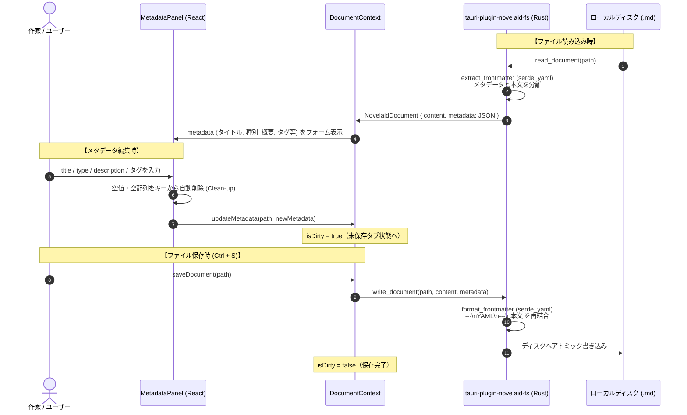

# メタデータ編集パネル実装仕様（`MetadataPanel`）

## 1. 概要とアーキテクチャ

本ドキュメントは、**`novelaide`** において、開いている個別ドキュメントの属性（YAML Frontmatter）を編集・保存する右ペインプラグイン **`MetadataPanel`** のプログラム実装仕様を定義するものである。

> [!IMPORTANT]
> **共通仕様・UI概念の参照元**:
> - 純粋なファイルフォーマット規約およびコア項目定義: [Frontmatterメタデータ共通仕様](../../novelaid-editor-docs/docs/dev/Frontmatterメタデータ仕様.md)
> - メタデータ編集パネルのUI概念・入力要件: [メタデータ編集パネル仕様](../../novelaid-editor-docs/docs/dev/メタデータ編集パネル仕様.md)

本実装は、`novelaide` の統合UIプラグインアーキテクチャ（`PanelRegistry`）に基づき、疎結合な右ペインパネル（`novelaid.panel.metadata`）として提供される。

---

## 2. システム連携シーケンス

---

## 3. コンポーネント実装詳細

### 3.1 対象ソースコード
- **コンポーネント**: `src/components/Metadata/MetadataPanel.tsx`
- **プラグイン登録**: `novelaid.panel.metadata`（右ペイン / アイコン: `Database`）

### 3.2 フォーム項目と制御ロジック

1. **基本プロパティ（コアメタデータ）**:
   - **タイトル (`title`)**: 1行 input (`<input type="text">`)
   - **種別 (`type`)**: 1行 input + HTML `<datalist id="meta-type-presets">`
     - プリセット候補: `chapter`, `character`, `location`, `plot`, `index`, `memo`
     - 自由入力を許容し、未入力時はキー自体を出力しない。
   - **概要 (`description`)**: 1行 input (`<input type="text">`)
     - 目次（`index.md`）自動生成時の一覧性を高めるため、1行テキスト入力として制限。
2. **空キーのクリーンアップ制御 (`handleChange`)**:
   - 入力値が空文字（`""`）または空配列（`[]`）の場合、オブジェクトから該当プロパティキーを `delete` して `updateMetadata` を呼び出す。
   - 不要な空キー（`type: ""` や `tags: []`）が YAML 出力に残留することを防止。
3. **タグ入力（`TagInput` コンポーネント）**:
   - 従来のカンマ区切り1行テキスト入力を刷新し、モダンなタグバッジ（Chip/ピル/トークンフィールド）UIを採用。
   - **入力確定操作**: `Enter`, `Tab`, カンマ（`,` / `、`）のキー押下時に現在の入力文字列をトリミングしてタグ化。
   - **日本語IME対策**: `compositionstart` / `compositionend` イベントおよび `e.nativeEvent.isComposing` を組み合わせ、日本語変換中の確定操作（Enter押下）ではタグ追加を抑止。
   - **タグの削除操作**: 各タグ内の「×」ボタンクリック、または入力欄が空の状態で `Backspace` キー押下により末尾タグを削除。
   - **重複・空文字抑止**: 前後の空白を自動トリミングし、空文字および既に登録済みのタグの重複追加を防止。
   - **クイック分類タグ連動**: `FolderTree`, `User`, `MapPin`, `Scroll` 等のクイック分類ボタンによるトグル操作とも完全同期。
4. **設定資料用プロパティ**:
   - `id`, `name`, `reading`, `age`, `gender`, `role` の入力フォーム。
5. **カスタムフィールドの動的追加・編集**:
   - 共通フィールド（`standardKeys`）以外の任意のキー/値を自由に追加・削除可能。
   - ユーザーが手動記述した独自キー（`summary` 等）も非破壊で安全に表示・編集。
